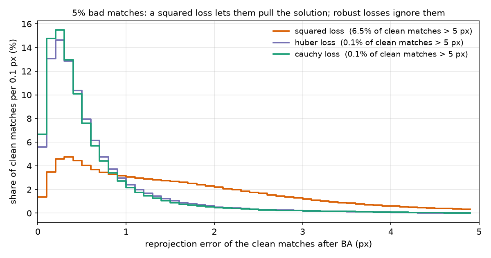

# MiniBA

**A small bundle adjustment in C++ with Ceres, run on a real phone reconstruction.** It takes the COLMAP/GLOMAP
model from my [Seen Again](https://github.com/mert5961/SeenAgain) project (150 frames of my desk, 40,137 points,
790,261 observations), checks that it computes reprojection exactly like COLMAP, breaks the solution on purpose
(noisy poses and points, a wrong focal length, 5% bad matches) and solves it again.

It is an independent learning project: I had used bundle adjustment for years through matchmove solvers (PFTrack,
SynthEyes) and through COLMAP/GLOMAP, and wanted to write one myself and measure it.



## What it does

| Step | File |
|---|---|
| Export a COLMAP model (one shared SIMPLE_RADIAL camera) to plain text | `tools/export_colmap.py` |
| Projection model, Ceres residual, solver, metrics (header-only) | `src/ba.h` |
| The five experiments below, written to `results/<seed>/report.md` | `src/miniba.cpp` |
| Synthetic scenes with known answers | `tests/test_synthetic.cpp` |
| COLMAP's own numbers via pycolmap, for the check | `tools/check_colmap.py` |
| Residual histogram above | `tools/plot_residuals.py` |

**The problem.** Unknowns: 150 camera poses (angle-axis + translation, 6 each), 40,137 points (3 each), and the
shared focal length *f* and radial term *k* (principal point fixed). One residual block per observation: the
projected pixel minus the observed pixel, 2 residuals, with automatic derivatives
(`AutoDiffCostFunction<…, 2, 6, 2, 3>`). Minimised with Levenberg–Marquardt; the points are eliminated with the
Schur complement, leaving a reduced camera system of 902 unknowns.

**Gauge.** BA can't know where the world is, how it's turned or how big it is (7 degrees of freedom). I leave the
gauge free (LM damping keeps it stable) and measure pose accuracy only after a similarity alignment (Umeyama on the
camera centres) to the reference solution. Camera-centre errors are in % of the scene size, because the model has
no metric scale.

**Reference.** The reference is COLMAP/GLOMAP's solution, not ground truth. "Error" below means "distance from
where COLMAP ended up", plus the reprojection error itself.

## Results (seed 42; seeds 7 and 123 in `results/`)

**1. Same projection as COLMAP.**

| metric | MiniBA (C++) | pycolmap |
|---|---|---|
| mean over all 790,261 observations | 0.624341 px | 0.624341 px |
| mean of per-point means | 0.516551 px | 0.516551 px (COLMAP's headline number) |

My first number didn't match COLMAP's 0.5166 px. The projection was right: COLMAP's headline number averages each
point's track first, then over points, so long tracks (larger errors) count less. Recomputing with pycolmap's own
projection gave exactly my value. Everything below uses the mean over observations.

**2. Polish (BA started from COLMAP's solution).** 5 iterations; RMS 0.918 → 0.902 px, the cameras move 0.06% of
the scene and 0.07°. The mean goes up slightly (0.624 → 0.635 px), because a squared loss minimises RMS, not the
mean.

**3. Noisy start, clean matches.** Each camera rotated by a random 0.5° (std), camera centres and all points moved by
1% of the scene size, focal length 5% too long, distortion set to 0.

| | mean px | camera centre (mean / max) | rotation (mean / max) | f | k |
|---|---|---|---|---|---|
| start | 21.26 | 1.63% / 3.79% | 0.45° / 1.69° | 1389.4 | 0 |
| after BA (8 iterations, 5.7 s) | 0.635 | 0.063% / 0.36% | 0.071° / 0.086° | 1322.2 | −0.0113 |

From a 21 px start it lands on the same minimum as the polish run (same error, same *f* and *k*).

**4. The same start + 5% bad matches.** 39,581 observations moved 20–80 px in a random direction. Errors are measured
on the clean observations, against their true pixels. Robust losses start down-weighting at 2 px.

| loss | clean-match error (mean px) | camera centre (mean, % scene) | f | outliers flagged > 4 px (precision / recall) |
|---|---|---|---|---|
| squared | 2.02 | 0.73 | 1325.5 | 0.33 / 1.00 |
| Huber | 0.657 | 0.075 | 1322.6 | 0.95 / 1.00 |
| Cauchy | **0.626** | **0.026** | 1323.1 | 0.91 / 1.00 |

Over 3 seeds: squared 2.02 px / 0.73–0.81% / *f* 1325.5–1344.8; Huber 0.657 px / 0.067–0.075%; Cauchy 0.626 px /
0.019–0.026% / *f* 1323.1–1323.2. With a squared loss, 5% bad matches make the cameras about 10× worse and the focal
length drifts; with Cauchy the result is as good as with no bad matches at all. Cauchy even lands closer to
COLMAP's solution than the clean squared-loss run (0.026% vs 0.063%), which suggests COLMAP/GLOMAP's own BA was not a
plain squared loss either (not checked in their code). The price: Cauchy took 119 iterations vs 40 for squared.

**5. Linear solvers** (noisy start, clean matches, Huber).

| linear solver | iterations | time | per iteration |
|---|---|---|---|
| DENSE_SCHUR | 69 | 37.8 s | 0.55 s |
| SPARSE_SCHUR | 70 | 37.1 s | 0.53 s |
| ITERATIVE_SCHUR + SCHUR_JACOBI | 45 | 20.4 s | 0.45 s |

All three reach the same cost. Dense and sparse Schur are the same speed here because the reduced camera system is
small (902 × 902); most of the time goes to evaluating 790k residuals and Jacobians and eliminating the points. With
thousands of cameras (city or satellite scale) the reduced system grows and the choice starts to matter. Iteration
counts change by a few between runs (12 threads sum in a different order), so the timings are rough.

## Limits

- The reference is COLMAP's solution, not surveyed ground truth; no GCPs, so no metric accuracy.
- Perturbations and bad matches are synthetic. Real bad matches are not random: repeated texture puts them close to
  the right place, which is harder than 20–80 px jumps.
- One camera model (SIMPLE_RADIAL), principal point fixed, one scene.

## Next steps

- **Other sensor models with the same solver:** a satellite RPC model (residual in image space with a small
  bias-correction block per image) and a 360° camera (residual as an angle between bearing vectors on the sphere).
- **Ground control points** as extra residuals, to get metric accuracy and a fixed gauge.
- Analytic Jacobians vs autodiff timing; a sweep of the robust-loss scale.

## Run it

Needs Ceres (`brew install ceres-solver cmake`) and, for the Python tools, `pycolmap numpy scipy matplotlib`.

```bash
python tools/export_colmap.py <colmap_model_dir> data/desk.txt
cmake -S . -B build && cmake --build build -j
./build/test_synthetic                      # known-answer tests
./build/miniba data/desk.txt --out results/seed42 --seed 42
python tools/plot_residuals.py results/seed42/residual_hist.csv docs/residuals.png
```

`data/desk.txt` (38 MB) is not in the repo; export it from Seen Again's model (`work/desk/sparse/0`).
